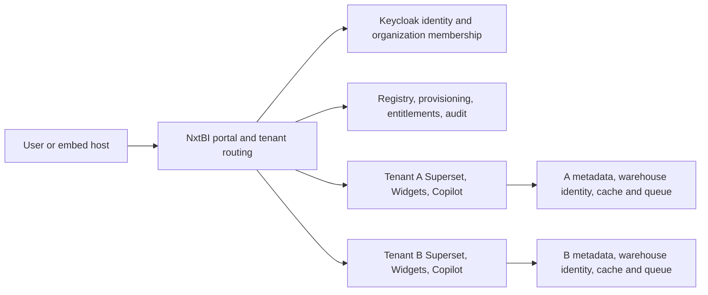

# NxtBI SaaS, row-level security, and namespaces

Use a shared NxtBI portal and provisioning service, with an isolated Superset
deployment for each customer by default. Give a private workspace its own
deployment when people who administer the parent customer must be excluded.
Share infrastructure selectively, such as an operator-managed PostgreSQL cluster
with separate databases and credentials. Reuse Keycloak for identity, Superset
for BI authorization, and database permissions for mandatory data isolation.

This combines a shared control plane with isolated customer data planes. Preset
documents a similar product boundary where each workspace launches an isolated
Superset instance. Metabase documents row and column security, database routing,
and impersonation as separate controls. These are useful patterns for NxtBI's
design. [AWS SaaS isolation models](https://docs.aws.amazon.com/pdfs/whitepapers/latest/saas-tenant-isolation-strategies/saas-tenant-isolation-strategies.pdf) ·
[Preset workspaces](https://docs.preset.io/docs/preset-vs-superset) ·
[Metabase data isolation](https://www.metabase.com/docs/latest/permissions/data-isolation-methods)

## What exists in this fork

The source audit used fork commit `eba884bb35` on November 26, 2026.

| Area | Source evidence and impact |
|---|---|
| Identity | Keycloak group mapping grants Gamma and the mapped organization roles at login. Organization admins can receive SQL Lab access. The mapper intentionally omits workspace groups. A member of multiple organizations receives additive roles, and local identity lookup uses `preferred_username`. [Identity and session configuration](../nxtbi/config/superset_config.py#L204) |
| Metadata and warehouse | The demo shares one Superset metastore, native asset identifiers and role namespace. A shared warehouse reader has schema-level SELECT. The bootstrap applies organization-specific Superset RLS and a deny-by-default rule to the shared `service_requests` dataset. [Capability matrix](../nxtbi/docs/CAPABILITY-MATRIX.md) · [Demo row policies](../nxtbi/bootstrap/bootstrap.py#L184) · [Warehouse grants](../nxtbi/seed/seed_demo_data.py#L341) |
| Dashboards and widgets | Classic and V2 reuse the native Dashboard asset. V2 data binding, history, and Widget SDK paths have their own authorization contracts. Native IDs, slugs, dashboard embed UUIDs, widget UUIDs, and V2 document revisions serve different purposes. [Dashboard V2 and Widget architecture](architecture.md#3-dashboard-v2-and-widgets) · [Native trust model](../SECURITY.md) |
| Copilot, MCP, and uploads | History is encrypted and keyed by user. Run and approval capabilities are actor-scoped. CSV import selects an authorized target, and its idempotency receipt is actor/operation-scoped. Tenant and workspace scope need to follow those records and capabilities before a service or store is shared. [Copilot API](../superset/copilot/api.py#L267) · [CSV import](../superset/copilot/upload.py#L310) |
| Background execution | Demo reports default to a fixed service account provisioned as Admin. Customer reports need an explicitly scoped executor and authorized delivery destinations. Queued work and result retrieval need the same tenant and identity checks as synchronous requests. [Report configuration](../nxtbi/config/superset_config.py#L417) · [Service account bootstrap](../nxtbi/bootstrap/bootstrap.py#L43) |
| Deployment | The existing Widgets Compose project already runs independently with its own PostgreSQL, Redis, and volumes. It offers a starting template for a two-customer pilot. [Widgets Compose](../nxtbi/widgets/docker-compose.yml) |

These are source findings. Historical checks cover two fixture organizations in
the demo and the Dashboard/Widget lifecycle. The proposed SaaS boundaries still
need end-to-end verification. [Existing verification](testing.md)

## What each namespace controls

| Namespace | Purpose and enforcement |
|---|---|
| **Tenant** | The customer boundary. An immutable `tenant_id` owns the account, domain, integrations, quotas, audit records, and deployment reference. Only verified memberships may enter it. |
| **Workspace** | An immutable `workspace_id` under one tenant for a project or business unit. The catalog checks workspace membership and maps workspace-local slugs to deployment-qualified native asset IDs. Private workspaces start in separate deployments. Shared workspaces require compatible administrator trust and enforceable native asset permissions. |
| **Row and column permissions** | Who can see that tenant's departments, regions, customer accounts, and sensitive columns. Enforce the tenant boundary at the warehouse. Use Superset RLS and roles for supported finer-grained BI filters. Where SQL Lab is available, enforce meaningful row and column restrictions in the warehouse for its actual connection identity. |
| **Runtime** | Sessions, queues, stored results, uploads, caches, and reports are scoped by the workload's deployment and tenant. Shared stores also enforce distinct credentials and access policies. Kubernetes namespaces organize these resources and provide a place to attach policy. |

A user can be a tenant administrator for one company and a dashboard viewer for
another. Switching tenants establishes a new active context and only the selected
tenant's roles apply. The application verifies the membership before entering the
workspace, serving an asset, or minting an embed token. Treat the host name, URL,
slug, request parameter, or browser token hint as a destination selector. Check
access on the server. [OWASP multi-tenant security guidance](https://cheatsheetseries.owasp.org/cheatsheets/Multi_Tenant_Security_Cheat_Sheet.html)

For example, the portal can show **North Coast → Finance** and link to its
verified analytics origin, `https://north-coast.analytics.example/`. The
registry resolves the workspace UUID, deployment, and native asset UUID. A
finance viewer opens a published dashboard. The warehouse credential limits
it to North Coast data and Superset RLS limits the dashboard to the viewer's
assigned region. SQL Lab requires equivalent warehouse-level restrictions.
The support workspace uses its own grants and gets its own deployment if it
requires privacy from the Finance administrators.

### Pick the deployment boundary per trust requirement

| Model | Appropriate use | Cost and qualification |
|---|---|---|
| Superset per customer, shared platform | Default for external customers using authoring, exports, embeds, Copilot, or admin workflows | More app instances, workers, and connections. Share trusted hosting, Keycloak, and managed database infrastructure while isolating application state and credentials. |
| Superset per private workspace or dedicated infrastructure | Separate administrators or explicit private-workspace, network, storage, or recovery requirements | Higher operating cost. Use the same immutable artifacts and provisioning workflow. Independently qualify backup, restore, access, and lifecycle. |
| Pooled Superset instance | Internal collaboration under one trust domain today. Consider a limited viewer-only product tier after evidence and cost justify it. | Requires every tenant-owned object path, role, worker, and storage read/write to be scoped. Native SQL/connector access and customer workspace administration stay outside an external pooled tier until their boundaries have been proven. |

## Identity, data, and application contracts

1. **Resolve one active tenant.** Map Keycloak organization IDs or validated group
   claims to internal UUIDs. Use OIDC `(iss, sub)` to link identities, with explicit
   account linking if the provider uses pairwise subjects across applications.
   Use Keycloak Organizations where the installed version's mapper and membership
   lifecycle meet requirements. A shared realm can manage organization membership
   and broker customer identity providers. Separate realms are an option where
   identity administration or federation policies need independent boundaries.
   Verify the organization claim on the configured Keycloak 26.4 image before rollout.
   Keep application roles and permissions scoped to the chosen workspace. Give
   tenant admins product admin capabilities and reserve native Superset Admin and
   infrastructure privileges for trusted operators. [Keycloak Organizations](https://github.com/keycloak/keycloak/blob/26.4.0/docs/documentation/server_admin/topics/assembly-managing-organizations.adoc) ·
   [OIDC subject and issuer](https://openid.net/specs/openid-connect-core-1_0.html#ClaimStability)
2. **Provision database credentials independently.** A tenant deployment gets its
   own Superset metadata database, runtime credentials, and separate migration
   identity. Use explicit connect grants and a per-tenant backup/restore target on
   shared PostgreSQL. Bind each Superset warehouse connector to a least-privilege
   tenant-specific database identity. Separate readers, ingestion writers, and
   schema owners. Restrict SQL Lab to tenants and roles whose warehouse grants are
   sufficient even for arbitrary SQL. Use Superset query filters as an additional
   policy layer. [Superset production security](https://superset.apache.org/docs/security/securing_superset/)
3. **Use PostgreSQL RLS when pooling rows.** Require a non-null tenant UUID on
   tenant-owned rows, scope natural-key uniqueness and foreign keys by tenant,
   and index common tenant predicates. Define read policies and write checks,
   including `WITH CHECK` where needed. Use a non-owner runtime role without
   superuser or `BYPASSRLS` privileges. Review `FORCE ROW LEVEL SECURITY` for
   owned tables.
   Use tenant-bound database principals for BI identities that can execute SQL.
   Transaction-local application context is suitable for a controlled service
   with a trusted query path. Treat application-set session state as untrusted on
   connections that accept customer SQL. Test connection reuse, pool modes, and
   both authorized and denied read/write behavior under the deployed role.
   [PostgreSQL 17 row policies](https://www.postgresql.org/docs/17/ddl-rowsecurity.html) ·
   [PgBouncer feature matrix](https://www.pgbouncer.org/features.html)
4. **Carry context into native and NxtBI surfaces.** Use a deployment-qualified
   asset catalog and check scope before resolving native IDs. Carry tenant,
   workspace, actor, audience, expiry, and operation or resource scope where
   appropriate through approvals, MCP delegation, embed issuance, and jobs.
   Revalidate membership and resource scope at sensitive actions, worker execution,
   and result retrieval. Give browsing, publishing, exporting, restoring, and
   copying explicit authorization. Treat cross-workspace copies as authorized
   imports that remap datasets, charts, widgets, history, and embeds. Keep native
   authorization and feature flags in force. [Native compatibility plan](upstream-maintenance-plan.md)
5. **Apply the scope through embeds, AI, and uploads.** Mint guest tokens on the
   tenant's backend after checking the target resource. Use explicit dashboard,
   widget, or dataset scope as supported, tenant-specific audiences and signing
   configuration, short expiry, and explicit allowed embed origins. On tenant
   switch recreate widget clients, token state, and event/filter scope. Scope
   Copilot threads, draft approvals, uploads, and idempotency receipts to the
   active tenant and workspace where applicable. Use tenant-selected ingestion
   storage and quotas. Prefer an approved model endpoint or local model by tenant
   policy, and limit data exposed to that provider. [Superset guest-token guidance](https://superset.apache.org/user-docs/using-superset/embedding/) ·
   [Widget provider](../superset-frontend/packages/superset-widgets/src/embed/SupersetProvider.tsx)
6. **Isolate stored results and operations.** Start with separate Redis and queues
   per isolation unit. For shared Redis require tenant-specific credentials, key
   and channel ACLs, and restricted commands. Use tenant-scoped object-store
   policies for uploads, exports, screenshots, and backups. Separate browser
   sessions by trusted tenant origin behind TLS. Audit actor, tenant, workspace,
   action, resource, and result. Track usage/quotas from verified context and keep
   sensitive data out of logs. For revocation, reconcile removals to zero grants,
   invalidate affected sessions and capabilities, and account for queued work.
   [Redis ACLs](https://redis.io/docs/latest/management/security/acl/) ·
   [OWASP storage, cache, and audit guidance](https://cheatsheetseries.owasp.org/cheatsheets/Multi_Tenant_Security_Cheat_Sheet.html)

## Tools and packages to use or evaluate

| Tool | Best fit for NxtBI |
|---|---|
| **Keycloak Organizations, Superset RBAC/subjects, PostgreSQL RLS** | Start with these. Keycloak signs in customers, the NxtBI registry establishes workspace membership, Superset authorizes resources, and least-privilege warehouse identities and policies constrain data. |
| **Docker Compose, then Kubernetes/Helm if warranted** | Test two deployments from one template now. At scale use repeatable infrastructure provisioning. In Kubernetes apply per-unit service accounts, RBAC, default-deny network policies with a supporting CNI, workload policy, secret separation, and quotas. [Docker Compose project names](https://docs.docker.com/compose/how-tos/project-name/) · [Kubernetes multitenancy](https://kubernetes.io/docs/concepts/security/multi-tenancy/) |
| **OpenTofu modules** | Optional for provisioning production database, secret, object-store, DNS, and network resources after the Compose contract is proven. [OpenTofu modules](https://opentofu.org/docs/language/modules/) |
| **Redis ACLs and PgBouncer** | Evaluate consolidation when Redis service counts or PostgreSQL connection budgets justify it. Verify production command/channel ACLs and pool compatibility with the chosen identity model. [Redis ACLs](https://redis.io/docs/latest/management/security/acl/) · [PgBouncer](https://www.pgbouncer.org/features.html) |
| **Apache Casbin RBAC with domains** | Optional in-process application policy for many workspace roles. Start with explicit membership and permissions in the existing app and control-plane database. [Casbin documentation](https://casbin.apache.org/docs/rbac-with-domains/) |
| **OpenFGA or SpiceDB** | Evaluate one if nested groups, object inheritance, and sharing across several products require a relationship graph. Use it for control-plane authorization with versioned model and revocation tests. Keep warehouse and Superset enforcement. [OpenFGA organization context](https://openfga.dev/docs/modeling/organization-context-authorization) · [SpiceDB relationships](https://authzed.com/docs/spicedb/concepts/relationships) |
| **Open Policy Agent** | Optional policy-as-code for gateways, services, or deployment admission when policy ownership spans systems. Keep policy decisions close to resource ownership and retain authoritative resource enforcement. [OPA](https://www.openpolicyagent.org/docs) |
| **WorkOS Directory Sync** | Optional managed enterprise provisioning when customer SCIM or directory integration demands it. Evaluate readiness and cost alongside self-managed Keycloak federation. [WorkOS directory provisioning](https://workos.com/docs/authkit/directory-provisioning) |
| **Playwright, pytest, pgTAP** | Reuse the Postgres/container and Widget SDK lifecycle fixtures for system checks. Add PG policy tests under real runtime roles, using pytest or pgTAP. [Existing lifecycle fixture](../nxtbi/copilot/tests/lifecycle_fixture/run.py) · [pgTAP](https://pgtap.org/documentation.html) |

## Delivery order and release evidence

1. **Two-tenant pilot.** Create an additive control plane under `nxtbi/` with
   tenant/workspace registry, one tenant origin per customer, and an idempotent
   provisioning template. Use two isolated Compose deployments and synthetic
   datasets. Activate routing only after database, role, and service checks pass.
   Record provisioning, active, suspended, and deletion states so a partially
   provisioned or disabled tenant cannot accept requests.
   Exercise Keycloak with separate users and a user in both customers. Verify
   customer-private metadata, warehouse rows, OIDC sessions, and workspace URLs.
2. **Verify BI and Copilot boundaries.** Extend the real browser and API lifecycle
   to cover V1/V2 create/edit/publish/restore, dataset listing, export and import,
   guest dashboard and widget rendering, SQL Lab where eligible, Copilot history
   and approvals, MCP calls, and CSV imports. Use matching dataset names and
   different values per tenant to prove data origin. Check denied cross-tenant
   resource access, no shared caches/results, revocation before async execution
   or result readback, and same-actor workspace switching, including Arabic RTL.
   Qualify report execution and delivery before enabling customer schedules.
3. **Operationalize onboarding and recovery.** Add customer invitations,
   directory reconciliation, suspend/offboard, audited operations, usage quotas,
   backup/restore, and rolling upgrades. Verify clean installs and upgrade from
   the previous release per tenant. Trial one tenant restore independently and
   verify that other tenants' data and routing are unaffected. Keep migrations
   separate from demo seeding, and preserve deployment-qualified native IDs or
   import mappings when migrating the existing demo.
4. **Measure before pooling.** Track time to provision, memory and connections
   per active tenant, query latency under concurrent load, backup/restore time,
   and patch rollout lead time. Use those metrics and customer requirements to
   decide what can safely share infrastructure. Preserve the separate tenant
   deployment contract until object, data, session, and worker isolation are
   continuously verified for the proposed pooled surfaces.

The existing [upstream maintenance plan](upstream-maintenance-plan.md) governs
new host changes. Keep the portal, tenant lifecycle services, Compose/Helm
packaging, and tests under `nxtbi/`. Scope any necessary Superset adapter change
to a supported extension or a narrow, owned patch, and run the two-tenant suite
against each new upstream candidate.
